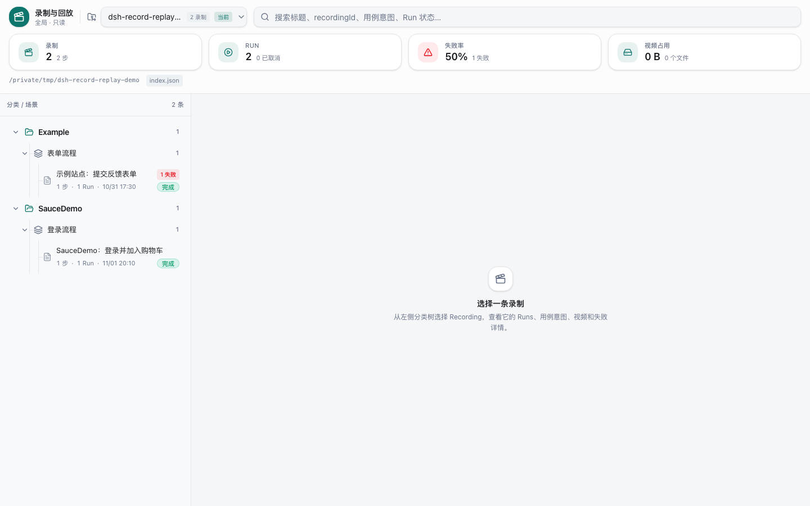
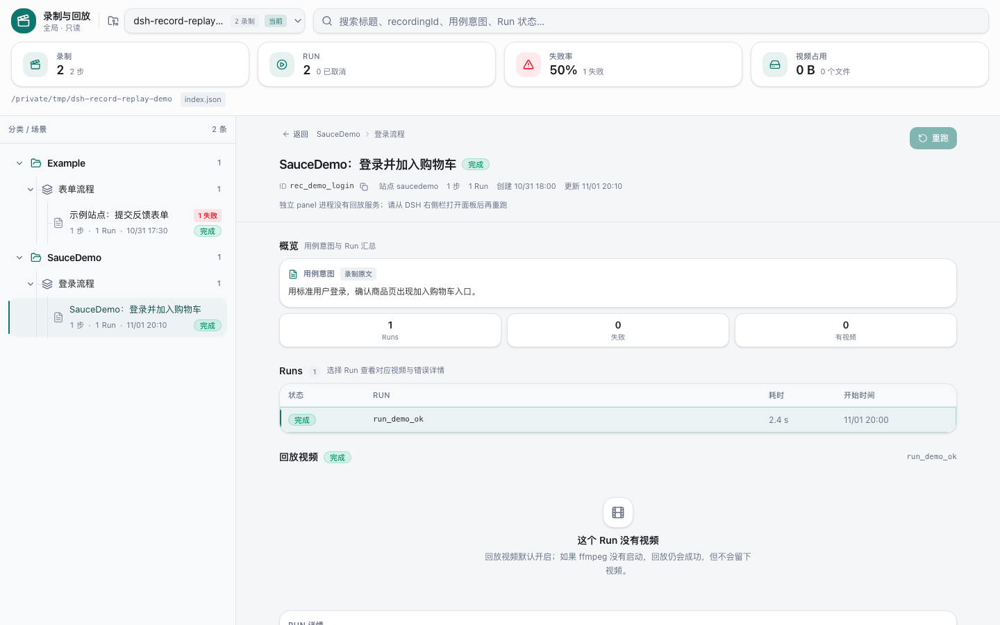
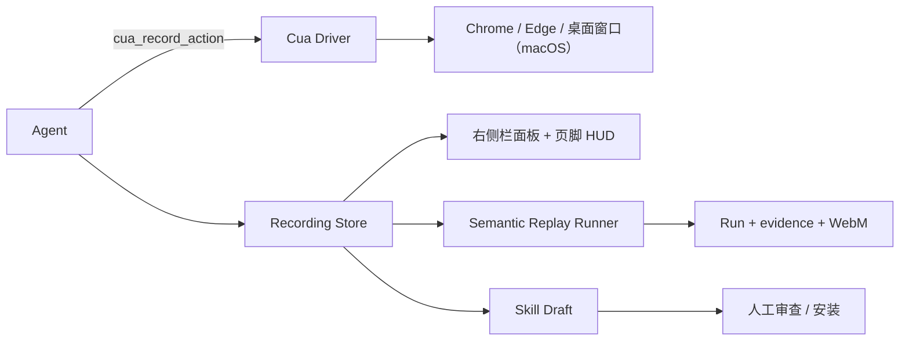

# dsh-record-and-replay

[](https://github.com/kakaCat/dsh-record-and-replay/actions/workflows/ci.yml)
[](LICENSE)
[](package.json)
[](package.json)
[](https://github.com/kakaCat/dsh-record-and-replay)

DSH 插件：把 Agent 通过 Cua Driver 执行的浏览器/桌面操作录成可复核的 **Recording**，支持确定性回放、右侧栏面板与实时 HUD、会话导出，并把成功流程沉淀为可审查的 **Skill**。

> npm 包名是 `dsh-record-and-replay`；插件 id 和 CLI 仍叫 `dsh-record-replay`，CLI 也响应 `dsh-record-and-replay`。
> 完整参数、事件格式和内部实现见 [REFERENCE.md](REFERENCE.md)。

## 定位

记录的是 **Agent 的 Cua 工具调用**，不是人类屏幕录制，也不是像素级视频理解：

| | 本插件 | 人类屏幕录制 |
|---|---|---|
| 记录对象 | `cua_record_action` 等语义动作 | 鼠标/键盘/像素 |
| 回放方式 | 重新观察页面、解析语义目标、逐步验证 | 播放视频或重放坐标 |
| 产物 | `steps.jsonl`、Run、失败证据、可安装 Skill | 一段视频 |

适合：浏览器流程回归、把成功流程沉淀成 Skill、审计 Agent 实际点了什么。
不适合：录制人的日常桌面操作、没有语义目标的纯 canvas 操作。

## 界面预览

独立只读 panel（演示数据）：

| 面板总览：分类 / 场景 / 录制 | 录制详情：用例意图、Runs 与回放 |
|---|---|
|  |  |

在 DSH 里，同一个面板挂在右侧栏；左栏页脚的「录制回放」入口在录制中会显示计时、步数和 Stop/Discard。

## 特性

- **录制**：`cua_record_start` / `cua_record_action` / `cua_record_stop` 记录浏览器语义动作（navigate、click、setValue、scroll、drag、assert）和桌面 AX 动作；支持 intent、幂等键、30 分钟自动停、`endReason`、丢弃（`cancelled`）。
- **确定性回放**：`cua_replay_start` 逐步重新观察、解析语义目标、执行并验证；失败即停，写 `run.json`、`steps.jsonl`、失败证据和 WebM 录屏。
- **面板与 HUD**：右侧栏跨项目浏览/搜索/统计/回收站/重命名/键盘导航；左栏页脚实时显示录制计时，可 Stop / 二次确认 Discard。
- **Skill 知识库**：`cua_skill_generate` → `cua_skill_review` → 人工确认安装 → `cua_skill_search` / `cua_skill_load`；`mode: "model"` 可用当前会话模型增强 Summary/Preconditions/Ambiguities，并生成 `memory.md`，失败自动回落模板。
- **会话导出**：`cua_record_export` 输出 `session.json`、`events.jsonl`（`session.started` / `agent.action` / `session.ended`）和可选 `suppressed.jsonl`。
- **隐私与同意**：`setValue` 全掩码；URL 拒绝列表、私密窗口拦截、独立的 `suppressed.jsonl`；录制同意元数据与可选 `explicit` 门。
- **可回归**：`dsh-record-replay test` 跑套件（JUnit、超时、失败继续，仅 CLI/CI，不占 Agent 工具面）；CI 覆盖 typecheck、单测、build、`check:boundary` 和 Playwright e2e。

## 工作方式



录制是 Agent 动作的**旁路**：工具调用成功后写 `steps.jsonl`，不阻塞浏览器动作；回放读取 completed Recording，重新解析语义目标而不是重放坐标。

## 快速开始

### 前置要求

- Web 自动化：macOS 与 Windows；Node.js ≥ 22；DSH ≥ `0.2.1-rc.5`
- macOS 需要 `cua-driver` ≥ 0.38 在 `PATH`，且 DSH 已获得 Accessibility / Screen Recording 权限；Windows Web 自动化使用兼容 Windows 的 Cua Driver 能力，桌面自动化暂不支持
- `native` transport 是 opt-in；macOS 需要宿主 bundle 身份为 `com.trycua.driver`

### 安装

```bash
git clone https://github.com/kakaCat/dsh-record-and-replay.git
dsh plugin --profile <profile> add link:/path/to/dsh-record-and-replay
```

重启 DSH Host 并刷新页面；插件清单出现 `record-replay` 即生效。录制、回放、Skill 默认开启，配置见下一节。

### 第一次录制与回放

```text
cua_record_start        { "title": "登录并加入购物车", "intent": "标准用户登录，确认商品页出现加入购物车入口" }
cua_record_bind_browser { "launch": "isolated", "profileName": "demo" }
cua_record_action       { "action": { "kind": "navigate", "url": "https://www.saucedemo.com/" } }
cua_record_action       { "action": { "kind": "setValue", "target": { "role": "textbox", "name": "Username" }, "value": "standard_user" } }
cua_record_action       { "action": { "kind": "click", "target": { "role": "button", "name": "Login" } } }
cua_record_action       { "action": { "kind": "assert", "check": { "kind": "url", "contains": "/inventory" } } }
cua_record_stop
cua_replay_start        { "recordingId": "rec_..." }
```

也可以直接用左栏页脚入口打开面板：浏览 Recording、看 Runs 和回放视频；录制中页脚显示计时和 Stop/Discard。

### 生成 Skill

```text
cua_skill_generate { "recordingId": "rec_...", "mode": "model" }
cua_skill_review   { "draftId": "draft_..." }
# 人工确认后
cua_skill_install  { "draftId": "draft_...", "decision": "confirmed" }
```

`mode: "model"` 可选；没有模型路由或模型输出不合格时自动回落模板，原因写入 `ambiguities`。

### 导出会话

```text
cua_record_export { "recordingId": "rec_..." }
# 默认写 .dsh/record-replay/exports/<recordingId>/session
```

导出目录只含 `session.json`、`events.jsonl` 和可选的 `suppressed.jsonl`；这是 Agent action log，不伪造 `mouse.click` / `window.changed` 等人类事件。

## 配置

最小配置（全部默认开启）：

```yaml
- id: record-replay
  name: dsh-record-and-replay
  config:
    recording:
      maxDurationSeconds: 1800
      consent: implicit
      privacy:
        deniedUrlPatterns: []
        blockPrivateBrowsing: true
    replay:
      video: true
    skill:
      autoFeedback: true
```

完整配置（transport、容量、视频、工具白名单、路径等）见 [REFERENCE.md](REFERENCE.md)。

### Docker 后端（可选）

独立 Cordis 插件行 `record-replay-docker`（包子路径 `dsh-record-and-replay/docker`）**默认关闭**，可在 DSH 插件页开启，或使用基本配置：

```yaml
- id: record-replay-docker
  name: dsh-record-and-replay/docker
  disabled: false
```

它复用现有工具、存储、面板和语义回放，但由插件管理与宿主机架构一致的 Linux 容器（amd64/arm64）。随包的 `docker/Dockerfile` 与 `entrypoint.sh` 提供 Xvfb、Openbox、Google Chrome/Chromium、Cua Driver 0.38.0 和 ffmpeg。

- 需要 Docker daemon；首次使用会在镜像缺失时构建按内容与架构寻址的 bundled image。AMD64 使用 Google Chrome，ARM64 使用 Debian Chromium，无需 Rosetta 仿真。
- 容器按工作区懒启动，在 runtime 销毁或插件行关闭时移除。命名 Cua profile 默认使用按工作区隔离的 home volume，不随容器删除。
- 仅支持 `launch: "isolated"`；宿主机 `existing` / `desktop` 会被拒绝，`native`-to-local fallback 不适用。
- 回放视频在容器内通过 `x11grab` 采集，经 bind mount 写入原有 Run 视频目录。
- DSH sandbox policy 不约束容器内部。

`image`、构建开关、显示尺寸、超时与 profile 持久化等字段及默认值见 [REFERENCE.md](REFERENCE.md#docker-backend)。

## 隐私与安全

- Recording、Run、Skill 都在工作区 `.dsh/` 下；`setValue` 值落盘前掩码，replay `values` 只在进程内使用。
- `recording.privacy.deniedUrlPatterns` 命中后步骤进 `suppressed.jsonl`，不进 `steps.jsonl`；私密窗口默认拒绝绑定。
- 面板与 Host 路由同源鉴权；Stop/Discard 从 manifest 的 `ownerSessionId` 派生 principal，不伪造归属。
- 漏洞上报、Cua 权限和录制数据边界见 [SECURITY.md](SECURITY.md)。

## 兼容性

| 项 | 要求 |
|---|---|
| DSH | `>=0.2.1-rc.5 <0.3.0`（`engines.dsh`） |
| Node.js | ≥ 22 |
| 平台 | Web：macOS / Windows；桌面：macOS only |
| 浏览器 | Chrome / Edge；支持 `existing`、`isolated`、`desktop` 三种绑定 |
| Cua | `mcp` 需 `cua-driver ≥ 0.38`；`native` 需 `@trycua/cua-driver` 0.28 |
| Panel | DSH 右侧栏 + 左栏页脚；独立 `panel` 命令只读 |

## 已知限制

- 浏览器绑定不支持 `key`；需要按键时用桌面绑定 + `cua_desktop_press_key`（桌面工具在独立插件行 `record-replay-desktop`，缺省关闭，插件页一键开启）。
- 不做人类桌面采集；只记录 Agent 的 Cua 工具调用。
- URL 策略只检查动作里出现的 URL；无私密窗口标题时无法识别。
- 独立 `panel` 进程没有回放/控制服务，重跑和 Stop/Discard 只在 DSH 挂载下可用。
- 更多边界见 [REFERENCE.md](REFERENCE.md) 的「Current limitations」。

## 文档

| 文档 | 内容 |
|---|---|
| [REFERENCE.md](REFERENCE.md) | 完整配置、transport、事件/存储格式、回放语义、桌面与 CLI 细节 |
| [docs/guides/cua-record-replay.md](docs/guides/cua-record-replay.md) | 交付结论、现状与已知缺口 |
| [docs/design/record-replay-panel.md](docs/design/record-replay-panel.md) | 面板设计、交互与实现取舍 |
| [docs/analysis/2026-11-01-gap-vs-open-codex-record-and-replay.md](docs/analysis/2026-11-01-gap-vs-open-codex-record-and-replay.md) | 与参考开源实现的对等审计 |
| [docs/guides/public-release.md](docs/guides/public-release.md) | 公开仓库/历史清理流程 |
| [CHANGELOG.md](CHANGELOG.md) | 版本变更 |

## 开发

```bash
pnpm install
pnpm exec tsc --noEmit
pnpm exec vitest run          # 全量单测
pnpm build
pnpm check:boundary
pnpm test:activity            # Playwright activity-view e2e
DSH_DOCKER_E2E=1 pnpm exec vitest run tests/integration/docker-runtime.spec.ts  # 真实 Docker 浏览器与录像
```

CI 在 macOS 上跑 typecheck/单测/build/boundary，在 Windows 上跑 Web 平台适配单测与 build，在 Ubuntu 上跑 Playwright e2e。

## 贡献与许可

- 贡献指南：[CONTRIBUTING.md](CONTRIBUTING.md)
- 安全策略：[SECURITY.md](SECURITY.md)
- 许可证：MIT，见 [LICENSE](LICENSE)
