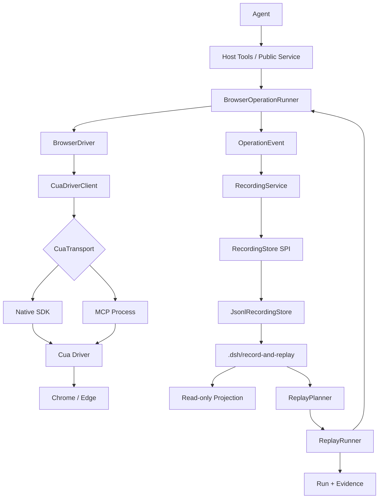

# Cua Driver 浏览器 Record/Replay 技术实现与扩展设计  serves: FR-1、FR-2、FR-3、FR-4、NFR-1、NFR-2

> 本文是实现契约，描述这些模块的接口与数据格式；实现已落地，代码入口见 `src/` 与 README。总体范围与排期见[实施计划](../plan/implementation-plan.md)。

## 摘要  serves: 全文

- **问题**：Agent 需要通过 Cua Driver 操作电脑浏览器，并留下可回看、可持久化、可真实重放的操作轨迹。
- **方案**：以 `BrowserOperationRunner` 统一语义动作与审计，以 `CuaDriverClient` 统一 Cua 原始调用，以 Semantic Step 为权威记录，并提供可替换 Driver/Store/Locator/Exporter 接口。
- **影响面**：新增一个单包多入口的 DSH 插件，不写 `dsh_browser`；运行数据写工作区 `.dsh/record-and-replay/`；公开 Host、库和测试三类使用方式。

## 背景与问题  serves: 全文

### 需求来源

| 需求编号 | 原始诉求 | 本设计如何回应 |
|---|---|---|
| FR-1 | “通过 Cua Driver 来操作电脑浏览器，而不用 dsh_browser” | 自有 Cua Transport、BrowserDriver 和 Session Registry，完整拥有调用链 |
| FR-2 | “Agent 操作后，我知道 Agent 做了什么操作” | 记录 started/finished 操作事件，提供实时投影和只读时间线 |
| FR-3 | “按照节奏实现 record-and-replay” | Recording 与 Run 分离，先 View Replay，后 Semantic Execute Replay |
| FR-4 | “在 .dsh 下生成记录，设计存放方式和文件位置结构” | 版本化 JSON/JSONL、证据目录、嵌套 Run、锁与原子写 |
| NFR-1 | 无人的自主执行需要安全、可取消、可恢复 | 策略预授权、每步取消、失败即停、崩溃恢复、脱敏和容量限制 |
| NFR-2 | “为功能扩展和别人引用留有扩展” | 稳定公共类型、适配器 SPI、子路径导出、版本协商和 conformance tests |

### 现状与代价

DSH 已有实验性 Cua Native/MCP Provider，但 `ctx.computerUse` 只负责具名 Provider 独占注册，不提供浏览器绑定、Recording、Replay 或跨 Session 工作流锁。直接让 Agent 调用上游工具可以完成动作，却不能保证目标重绑、持久步骤、恢复和可移植回放。

### 为什么是现在

执行链、记录链和存储契约如果后补，容易把短期 `target_id/tab_id/element_token` 固化进脚本，后续无法可靠重放。必须在第一阶段就定义语义步骤、调用上下文和公开扩展边界。

## 目标与非目标  serves: 全文

### 目标

- Agent 不调用 `dsh_browser_*`，可通过 Cua Driver 在本机 Chrome/Edge 完成浏览器任务。
- 每个 Agent 动作至多形成一条逻辑步骤，并准确呈现 running/success/error/interrupted。
- Recording 可流式读取、导出、崩溃恢复，所有证据路径均可移植。
- Execute Replay 在新 Run 中重新绑定窗口、Tab 和元素，不修改原 Recording。
- 第三方可实现新的 Driver、Locator、Store 或 Exporter，并复用同一 conformance suite。
- 核心类型可被纯 Node 或测试进程引用，不加载 Electron、DSH Host 或 Cua 原生二进制。

### 非目标

- 不录制人的鼠标键盘，不提供人工接管和 CAPTCHA 绕过。
- 不用 Cua 原始 `action.json` 代替跨版本 Semantic Step。
- 不让 `run_steps/run_script` 成为绕过 Recorder、取消和权限检查的旁路。
- 不在 V1 支持复杂多 Tab 拓扑、跨应用桌面流程、视频优先回放和在线协作编辑。
- 不在 V1 拆成多个 npm 包；源码边界和子路径导出先稳定，确有需要时再物理拆包。

## 方案总览  serves: FR-1、FR-2、FR-3、FR-4

**一句话方案**：所有 Agent/Replay 语义动作经过 `BrowserOperationRunner` 形成 Operation Event，Cua 原始调用再统一经过 `CuaDriverClient`；Recording 保存 Semantic Step，Replay 通过 BrowserDriver 重新解析目标并写独立 Run。



### 关键概念

- **Transport**：Native SDK 或 MCP 的传输适配，只懂工具目录和原始调用。
- **BrowserDriver**：把统一 BrowserAction 映射为某个自动化实现；V1 实现为 `CuaBrowserDriver`。
- **Binding**：一次运行期的浏览器绑定，含短期窗口/target/tab 引用，不持久化。
- **Semantic Step**：可持久化的业务动作，使用 URL、role/name/text 等语义目标。
- **Recording**：一次 Agent 操作的权威、只追加记录。
- **Run**：从 Recording 发起的一次真实执行，永不改写原 Recording。

### 主时序

1. Host 从工具执行上下文得到真实 `ownerSessionId/callId`，创建 `OperationContext`。
2. `BrowserOperationRunner` 接收 BrowserAction，分配 seq/stepId，并令 RecordingService 写入 `step.started`。
3. BrowserDriver 确保 Binding 和短期 ref 有效；CuaBrowserDriver 的原始调用再经过 CuaDriverClient。
4. 绑定、定位、执行成功或失败后，OperationRunner 统一写 `step.finished`，再发布 UI 已完成事件。
5. Stop 时等待写队列落盘，完成 manifest 并释放锁。
6. Replay 使用独立 `origin=replay` 上下文，禁止写入来源 Recording。

这里有两个不同层级的入口：`BrowserOperationRunner` 是所有 Driver 共用的语义动作管线，负责审计；`CuaDriverClient` 只是 Cua 原始工具调用的唯一入口，负责协议、能力、取消和错误映射。第三方 Driver 不经过 CuaClient，但仍经过 OperationRunner，因此不会失去 Recording/Replay 能力。

## 架构与依赖  serves: FR-1、FR-2、FR-3、NFR-2

### 源码目录设计

V1 采用**单包、多入口、内部分层**：

```text
dsh-record-and-replay/
  package.json
  tsconfig.json
  vitest.config.ts
  src/
    index.ts                         # 无副作用公共类型出口
    core/
      api.ts                         # Recording/Replay 公共服务类型
      actions.ts                     # BrowserAction Discriminated Union
      events.ts                      # Operation/Step/Run Event
      ids.ts                         # branded ID、生成与校验
      errors.ts                      # 稳定错误码与 Error 基类
      json.ts                        # JsonValue、安全序列化
      version.ts                     # Schema/Feature 版本
    driver/
      api.ts                         # BrowserDriver、Binding、Observation SPI
      operation-runner.ts            # 所有 Driver 共用的语义动作与审计管线
      registry.ts                    # Driver 注册、选择、disposer
      mutex.ts                       # Binding 级互斥
      testing-contract.ts            # Driver 契约测试类型
    cua/
      client.ts                      # 唯一 Cua 调用入口
      transport.ts                   # CuaTransport SPI
      native-transport.ts            # 动态 import Native SDK
      mcp-transport.ts               # MCP 调用与重连适配
      capabilities.ts                # 工具目录与版本能力探测
      browser-driver.ts              # BrowserAction → Cua tools
      bindings.ts                    # CuaSessionRegistry
      references.ts                  # 短期 ref/token 失效与重绑
      error-map.ts                   # 上游错误 → 稳定错误码
    recording/
      api.ts                         # RecordingService 公共接口
      service.ts                     # 生命周期、seq、去重、事件订阅
      schema.ts                      # Manifest/Step Zod Schema
      projector.ts                   # JSONL → Timeline/Executable Steps
      redaction.ts                   # 持久化前脱敏管线
    replay/
      api.ts                         # ReplayService 公共接口
      planner.ts                     # 能力/版本/Secret/步骤预检
      runner.ts                      # Run 状态机与逐步执行
      locator.ts                     # LocatorStrategy 组合与唯一性检查
      evidence.ts                    # 失败证据与相对路径引用
    store/
      api.ts                         # RecordingStore/EvidenceStore/Exporter SPI
      fs/
        paths.ts                     # Root containment、ID、相对路径校验
        jsonl-store.ts               # RecordingStore 的 JSONL 实现
        atomic-json.ts               # 临时文件 + rename
        append-queue.ts              # 有界串行写队列与 backpressure
        lock.ts                      # writer lock 与 stale recovery
        recovery.ts                  # 坏尾诊断、备份与修复
        export.ts                    # .dshreplay 导出
    host/
      index.ts                       # Cordis 插件入口与生命周期
      service.ts                     # ctx.cuaRecordReplay 实现
      tools.ts                       # Agent 工具投影，无业务规则
      remote.ts                      # UI 的受保护只读/控制 API
      config.ts                      # 操作者配置与能力门控
      principal.ts                   # 从执行上下文生成 Principal
    client/
      index.ts                       # Client Slot 注册，不 import Node 模块
      activity-model.ts              # 只读 ViewModel
      activity-view.tsx              # 时间线与 Run 详情
    testing/
      fake-transport.ts              # 可编程 CuaTransport
      memory-store.ts                # 内存 RecordingStore
      fixtures.ts                    # Semantic Steps/Session Events
      conformance.ts                 # 第三方扩展复用的测试套件
  tests/
    unit/
    integration/
    e2e/
    fixtures/
      browser-app/                   # 本地确定性浏览器页面
  docs/
```

### 依赖方向

```text
core
  ↑
driver/api        store/api
  ↑                ↑
cua/*             store/fs/*
  ↑                ↑
recording/* ───────┘
  ↑
replay/* → driver/api + store/api
  ↑
host → recording + replay + cua + store/fs
client → host 的只读 DTO（不依赖任何 Node 实现）
testing → core + driver/api + store/api
```

禁止：

- `core` import Cordis、Electron、Node fs 或 Cua SDK。
- `cua` import Host tools 或 React。
- `store/fs` import RecordingService/ReplayRunner，避免存储反向依赖业务。
- Replay 直接调用 Native SDK/MCP，必须重新经过 BrowserDriver 和 Client。
- 第三方 deep import `src/*` 或 `lib/internal/*`。

### package.json 公共出口

```json
{
  "name": "dsh-record-replay",
  "type": "module",
  "exports": {
    ".": { "types": "./lib/types/index.d.ts", "import": "./lib/index.js" },
    "./core": { "types": "./lib/types/core/api.d.ts", "import": "./lib/core/api.js" },
    "./driver": { "types": "./lib/types/driver/api.d.ts", "import": "./lib/driver/api.js" },
    "./cua": { "types": "./lib/types/cua/client.d.ts", "import": "./lib/cua/client.js" },
    "./cua/native": { "types": "./lib/types/cua/native-transport.d.ts", "import": "./lib/cua/native-transport.js" },
    "./store": { "types": "./lib/types/store/api.d.ts", "import": "./lib/store/api.js" },
    "./store/fs": { "types": "./lib/types/store/fs/jsonl-store.d.ts", "import": "./lib/store/fs/jsonl-store.js" },
    "./host": { "types": "./lib/types/host/index.d.ts", "import": "./lib/host/index.js" },
    "./testing": { "types": "./lib/types/testing/index.d.ts", "import": "./lib/testing/index.js" }
  }
}
```

根入口和 `core` 无副作用；只有 `./host` 注册 Cordis 插件，只有 `./cua/native` 在被实际调用时动态加载原生 SDK。`./cua` 本身不触发 Native import。

### 外部依赖与不可用行为

| 依赖 | 用途 | 不可用行为 |
|---|---|---|
| `@trycua/cua-driver` | Native Transport | 仅 Native 初始化失败，核心类型、MCP、查看历史仍可用 |
| DSH MCP Client | MCP Transport | 返回 `CUA_TRANSPORT_UNAVAILABLE`，不自动切换 Native |
| Cordis / DSH Tools | Host 生命周期与 Agent 工具 | 库模式仍可使用 core/store/testing |
| Node 22 fs/crypto | JSONL、锁、哈希和原子写 | 初始化 Store 失败，不执行任何浏览器动作 |
| Zod | 持久 Schema 与运行时边界校验 | 坏数据响亮失败并保留原文件 |

Cua SDK 作为 Native 入口的按需依赖锁定版本；公共接口不暴露 SDK 类型。MCP 与 Native 使用同一 `CuaTransport`，允许后续独立发布实现。

## 数据模型  serves: FR-2、FR-3、FR-4、NFR-1

### 核心公共类型

```ts
type RecordingId = `rec_${string}`
type RunId = `run_${string}`
type StepId = `step_${string}`
type Origin = 'agent' | 'replay' | 'internal'

type BrowserAction =
  | { kind: 'navigate'; url: string }
  | { kind: 'click'; target: SemanticTarget }
  | { kind: 'setValue'; target: SemanticTarget; value: string; secretRef?: string }
  | { kind: 'scroll'; target?: SemanticTarget; deltaX: number; deltaY: number }
  | { kind: 'key'; target?: SemanticTarget; key: string }
  | { kind: 'wait'; condition: WaitCondition; timeoutMs: number }
  | { kind: 'screenshot'; scope: 'tab' | 'window' }

interface SemanticTarget {
  url?: { origin?: string; path?: string }
  role?: string
  name?: string
  text?: string
  css?: string
  extensions?: Record<string, JsonValue>
}

interface OperationContext {
  principal: { sessionId: string; agentId: string }
  callId: string
  origin: Origin
  recordingId?: RecordingId
  runId?: RunId
  signal: AbortSignal
}
```

`value` 只存在于进程内动作；进入持久层前必须经过 Redactor。持久化步骤保存 `redacted` 或 `secretRef`，不保存 Secret 明文。

### Recording Manifest

```ts
interface RecordingManifest {
  schemaVersion: 1
  recordingId: RecordingId
  title: string
  status: 'recording' | 'completed' | 'failed' | 'interrupted'
  ownerSessionId: string
  driver: { id: string; version: string; transport: 'native' | 'mcp' | string }
  browser: { app: string; startUrl?: string }
  createdAt: string
  updatedAt: string
  completedAt?: string
  lastSeq: number
  stepCount: number
  stepsSha256?: string
  assetRoot: 'assets'
  extensions?: Record<string, JsonValue>
}
```

不变量：

- ID 全局由 Store 生成并校验；目录名必须与 manifest ID 完全一致。
- seq 从 1 单调递增，不因失败或取消复用。
- `stepId + callId` 在 Recording 内唯一；started/finished 共享该键。
- Recording completed 后步骤不可追加；编辑或修正必须 fork 新 Recording。
- `lastSeq/stepCount` 只是摘要，JSONL 是步骤事实来源。
- `stepsSha256` 在 completed 时计算；Run 记录该哈希以证明输入版本。

### Step Event

```ts
interface StepStarted {
  type: 'step.started'
  schemaVersion: 1
  stepId: StepId
  seq: number
  callId: string
  origin: Origin
  action: BrowserAction
  startedAt: number
  extensions?: Record<string, JsonValue>
}

interface StepFinished {
  type: 'step.finished'
  schemaVersion: 1
  stepId: StepId
  callId: string
  status: 'success' | 'error' | 'cancelled'
  finishedAt: number
  durationMs: number
  resultSummary?: JsonValue
  error?: PublicError
  evidence?: string[]
}
```

`step.started` 中的秘密必须在 append 前脱敏；不能先写原始值再事后清洗。没有 finished 的 started 在恢复投影中为 `interrupted`。

### Run Manifest

```ts
interface ReplayRun {
  schemaVersion: 1
  runId: RunId
  recordingId: RecordingId
  recordingSha256: string
  status: 'preparing' | 'running' | 'completed' | 'failed' | 'cancelled'
  currentStepId?: StepId
  driver: { id: string; version: string; transport: string }
  createdAt: string
  startedAt?: string
  finishedAt?: string
  error?: PublicError
}
```

每次执行创建新 Run。Run 的 steps.jsonl 使用同样 started/finished envelope，但增加 `sourceStepId` 和 `attempt`，允许未来在不改文件结构的情况下增加重试。

### 存储实现

根目录固定为 `<workspaceRoot>/.dsh/record-and-replay/`，目录树、锁、tmp 和 exports 以[实施计划的存储设计](../plan/implementation-plan.md#42-存储根与目录约定)为准。

`JsonlRecordingStore` 实现要求：

1. `open/create` 先验证 root，再以 `wx` 创建独占文件，避免覆盖已有 Recording。
2. 每个 Recording 一个 `AppendQueue`；所有 append 串行，队列有界，写满时向 Recorder 施加 backpressure。
3. started/finished 按完整 UTF-8 行 append；完成事件落盘后才发布 persisted 通知。
4. manifest/run 使用同目录临时文件 + flush + rename；不直接覆盖写。
5. 图片/视频先写 `.part`，校验大小和 hash 后 rename；JSON 只引用相对路径。
6. 读取使用 stream 和 seq 游标，不把整个 Recording 读入内存。
7. 关闭时停止接收新事件、等待队列、flush、更新终态、释放锁，顺序不可颠倒。

### 锁与恢复

- lock 内容：`version/ownerSessionId/pid/hostname/startedAt/heartbeatAt/randomOwnerToken`。
- 创建使用 `wx`；heartbeat 更新自己的 token，禁止覆盖他人 lock。
- stale 判定同时考虑 heartbeat、进程存活和 randomOwnerToken；不能仅凭 mtime 抢锁。
- Store 回收 stale lock 后，把未完成的 Recording/Run 标为 interrupted/failed，不继续旧执行。
- JSONL 坏尾加载时保留现场并报告；显式修复先备份再截断。
- 恢复不重新发送任何浏览器动作。

### Schema 与扩展版本

- `schemaVersion` 只描述持久格式；npm package semver 只描述代码 API；`driver.capabilities` 描述运行时能力，三者独立。
- 当前版本字段默认严格校验；第三方扩展只能放在 `extensions`，键使用反向域名，如 `com.example.viewport`。
- 未知 action/locator/exporter kind 返回 `UNSUPPORTED_*`，不可静默忽略。
- 迁移采用 `v1 → v2` 纯函数链，读取时在内存迁移；不修改旧文件。新写入只写当前版本。
- 公共联合类型新增 kind 会影响 exhaustive switch，按 semver 在 major 前明确标注为扩展点；持久 Schema 的读取仍保留旧 kind 支持。

## 接口设计  serves: FR-1、FR-2、FR-3、NFR-2

| 编号 | 接口 | 输入 | 输出 | 失败与错误 | 兼容性 |
|---|---|---|---|---|---|
| IF-1 | `CuaTransport` | 工具目录查询、工具名/JSON 参数、AbortSignal | 原始目录/结果、关闭句柄 | 能力缺失、连接断开、超时 | 不暴露上游类型；按 Transport contract 测试 |
| IF-2 | `BrowserDriver` | bind/observe/resolve/execute/release | Binding、Observation、ActionResult | 绑定失效、目标歧义、动作不支持 | Driver ID + capability 协商；允许第三方实现 |
| IF-3 | `RecordingService` | Principal、浏览器配置、start/stop/list/read | Recording 摘要、步骤流、订阅 | 未授权、锁冲突、限额、坏数据 | Host 公共 API；新增只读方法可向后兼容 |
| IF-4 | `RecordingStore` | Manifest、Step Events、Assets、游标 | 持久句柄、流式事件、恢复报告 | 路径非法、写失败、坏尾、锁失效 | Store SPI；文件布局独立版本化 |
| IF-5 | `ReplayService` | RecordingId、执行选项、RunId/cancel | Plan、Run、状态订阅 | 步骤不支持、定位失败、断言失败、取消 | Execute 非幂等；Run 结果永久可查询 |
| IF-6 | Extension Registry | Driver/Locator/Redactor/Exporter + disposer | 注册 ID、能力查询 | 重名、热切换冲突、契约失败 | 反向域名扩展键；禁止 active Run 热替换 |
| IF-7 | `ctx.cuaRecordReplay` / Host Remote | 可信 Principal、命令或查询 | DTO、事件流、控制结果 | Principal 不符、功能关闭、权限不足 | Agent/UI 共用应用服务；不暴露内部对象 |

#### IF-1 CuaTransport

**语义**

```ts
interface CuaTransport {
  readonly kind: 'native' | 'mcp'
  listTools(signal: AbortSignal): Promise<CuaToolCatalog>
  callTool(name: string, args: JsonObject, context: OperationContext): Promise<CuaRawResult>
  close(): Promise<void>
}
```

Transport 只做协议、超时、取消和原始错误传递，不做 Record、Replay 或 Session 授权。`CuaDriverClient` 负责原始调用计时、目录缓存、重连后失效处理和稳定错误映射；步骤级 started/finished 由上层 OperationRunner 统一生成。`run_script/run_steps` 若未来开放，必须先在 Client 内展开为可审计步骤或声明为不可拆分的原子动作。

**错误码**

`CUA_TRANSPORT_UNAVAILABLE` 可检查安装后重试连接；`CUA_CAPABILITY_MISSING` 不应重试同一版本；`CUA_CALL_TIMEOUT` 和 `CUA_TRANSPORT_DISCONNECTED` 必须先读取新状态，禁止直接重放写动作；`OPERATION_CANCELLED` 不表示输入已回滚。

**兼容性**

Transport 接口不包含 SDK 类、MCP 消息类或上游 JSON Schema 类型。工具目录按名称和 inputSchema 动态校验；升级 Cua 版本必须重新跑 capability probe 和 contract tests。

**幂等与重试**

`callTool` 默认不自动重试。观察类动作只有在上游明确未执行且错误可分类时才允许有限重连；写动作永不因超时而自动重发。

#### IF-2 BrowserDriver

**语义**

```ts
interface BrowserDriver {
  readonly id: string
  capabilities(): Promise<DriverCapabilities>
  bind(input: BindBrowserInput, context: OperationContext): Promise<BrowserBinding>
  observe(binding: BrowserBinding, options?: ObserveOptions): Promise<Observation>
  resolve(binding: BrowserBinding, target: SemanticTarget, observation: Observation): Promise<ResolvedTarget>
  execute(binding: BrowserBinding, action: BrowserAction, resolved: ResolvedTarget | undefined, context: OperationContext): Promise<ActionResult>
  release(binding: BrowserBinding): Promise<void>
}
```

Binding 是内存对象，含 driver 私有数据和失效代数；不能直接 JSON 序列化进 Recording。Observation 带 `observationId`，新快照、导航或重连使旧 ResolvedTarget 失效。Resolve 必须验证唯一性、可见性和 URL precondition。

**错误码**

`BROWSER_BINDING_STALE` 触发一次重新 bind；`TARGET_NOT_FOUND/TARGET_AMBIGUOUS/TARGET_STALE` 进入失败证据，不盲点第一个；`ACTION_UNSUPPORTED` 在 Planner 阶段优先发现；`BROWSER_PERMISSION_DENIED` 直接终止当前工作流。

**兼容性**

第三方 Driver 使用稳定 `BrowserAction/SemanticTarget/Observation`，通过 `capabilities` 声明支持范围。新增私有数据放 Binding 内部，不修改公共 Manifest。Driver 注册和热切换受 IF-6 限制。

**幂等与重试**

bind/release 可安全重入由实现保证；execute 不幂等。Binding stale 只允许在未发送动作前重绑，动作结果未知时不得自动重试。

#### IF-3 RecordingService

**语义**

```ts
interface RecordingService {
  start(input: StartRecordingInput, principal: Principal): Promise<RecordingDescriptor>
  stop(id: RecordingId, principal: Principal): Promise<RecordingDescriptor>
  get(id: RecordingId): Promise<RecordingDescriptor>
  list(query?: RecordingQuery): Promise<RecordingPage>
  readSteps(id: RecordingId, cursor?: StepCursor): AsyncIterable<ProjectedStep>
  subscribe(id: RecordingId, listener: (event: RecordingViewEvent) => void): () => void
}
```

Principal 由 Host 从真实执行上下文创建，调用方不能通过传 ownerSessionId 冒充其他 Session。Start 创建 writer；Stop 等待持久化并关闭 writer。Read/list/subscribe 不触发 BrowserDriver。

**错误码**

`RECORDING_NOT_FOUND` 不重试；`RECORDING_LOCKED` 表示仍有活跃 writer；`RECORDING_ALREADY_COMPLETED` 表示不能追加；`RECORDING_LIMIT_EXCEEDED` 需要停止或调整操作者限额；`FORBIDDEN` 表示所有权不符。

**兼容性**

DTO 只包含公开 ID、摘要和相对资源引用，不包含 Store 文件句柄、Binding 或 SecretResolver。新增 optional 查询字段保持向后兼容；返回额外字段不保证 Agent 工具的 strict output schema 直接接受，Host 需显式投影。

**幂等与重试**

start 支持调用方提供 `idempotencyKey`，同一 Principal + key 返回同一 Recording；stop 幂等。任何 start/stop 重试都不能重复执行浏览器动作。

#### IF-4 RecordingStore

**语义**

Store 负责事实持久化，不负责业务授权和 BrowserAction 解释。写接口只接受已脱敏、已校验的事件；读接口返回流式结果和恢复诊断。`MemoryStore` 与 `JsonlRecordingStore` 必须通过同一 contract suite。

**错误码**

`STORE_PATH_ESCAPE` 和 `STORE_INVALID_ID` 在打开文件前拒绝；`STORE_LOCK_LOST` 后禁止继续写；`STORE_CORRUPT_JSONL` 保留原文件；`STORE_DISK_FULL/STORE_LIMIT_EXCEEDED` 触发失败状态，不删除旧数据；`STORE_UNSUPPORTED_VERSION` 不尝试写旧 Schema。

**兼容性**

Store SPI 与文件布局版本分离。第三方可实现 SQLite/远程 Store，但必须满足 seq、started/finished、恢复语义和相对证据引用。文件布局变更通过新 schemaVersion 和迁移函数，不原地覆盖旧版。

**幂等与重试**

事件包含 `recordingId/stepId/type` 去重键；同一 writer 重试队列 append 不得产生两个逻辑步骤。底层 fs 错误只有调用方能确认未写入时才重试，恢复后对账 JSONL。

#### IF-5 ReplayService

**语义**

```ts
interface ReplayService {
  plan(recordingId: RecordingId, options: ReplayOptions): Promise<ReplayPlan>
  execute(recordingId: RecordingId, options: ReplayOptions, principal: Principal): Promise<RunId>
  getRun(runId: RunId): Promise<ReplayRun>
  readRunSteps(runId: RunId, cursor?: StepCursor): AsyncIterable<ProjectedRunStep>
  cancel(runId: RunId, principal: Principal): Promise<ReplayRun>
}
```

Plan 只读，检查 Schema、Driver 能力、语义 Locator、SecretResolver 和 Recording 完整性。Execute 只接受 `completed` 且哈希匹配的 Recording；interrupted/failed Recording 只能查看、导出或修复后 fork，不能直接执行。Execute 创建新 Binding/Run，按 seq 执行，每步前检查取消，完成后写断言和证据。View/Plan 不创建 Run。

**错误码**

`REPLAY_DISABLED` 表示操作者策略未预授权；`REPLAY_UNSUPPORTED_STEP` 在 Plan 返回具体 stepId；`RECORDING_HASH_MISMATCH` 防止基于已变化输入执行；`ASSERTION_FAILED` 和 `REPLAY_TARGET_LOST` 终止 Run；`RUN_NOT_FOUND/RUN_ALREADY_TERMINAL` 不重试。

**兼容性**

ReplayOptions 只接受声明字段，未知字段拒绝。新增执行策略通过明确 `strategy` union，而不是改变默认 `semantic-v1` 行为。旧 Run 永远保留原 driver/schema 版本供诊断。

**幂等与重试**

Execute 明确不幂等；调用方用 `idempotencyKey` 只能防止重复创建 Run，不能把真实动作变成可安全重试。Cancel 幂等，取消后读取新状态，不假设已执行动作回滚。

#### IF-6 Extension Registry

**语义**

注册表支持 `BrowserDriver`、`LocatorStrategy`、`Redactor`、`EvidenceExporter`。注册返回 disposer；按 `id` 唯一索引。Locator 按显式 priority 组合，Exporter 根据 format 选择，Redactor 按固定顺序执行且不能恢复已删除字段。

**错误码**

`EXTENSION_ALREADY_REGISTERED` 拒绝重名；`EXTENSION_CONTRACT_INVALID` 表示 capability/conformance 不符；`EXTENSION_IN_USE` 表示活跃 Recording/Run 不允许卸载；`LOCATOR_UNSUPPORTED` 表示目标类型未实现。

**兼容性**

扩展 ID 和 extensions key 使用反向域名。内置 ID 保留 `dsh.*`；第三方不得使用。V1 启动期注册，active writer/Run 期间冻结；热重载只有未来引入完整迁移和暂停协议后才能开放。

**幂等与重试**

同一实例重复注册返回原 disposer 或明确失败，由 registry 统一实现；卸载幂等。注册失败必须完整回滚该扩展的所有副作用。

#### IF-7 ctx.cuaRecordReplay / Host Remote

**语义**

Host 应用服务组合 Recording/Replay，对 Agent 工具和 UI Remote 提供同一用例。公共 Cordis 类型通过模块扩展声明：

```ts
declare module '@deepseek-ai/cordis' {
  interface Context {
    cuaRecordReplay: RecordingService & ReplayService
  }
}
```

Agent 工具仅负责 Schema、权限和 DTO 投影；UI 只读接口默认分页，控制接口校验 Session binding 和 operator config。任意网页不能直接 POST loopback 执行 Replay。

**错误码**

`FEATURE_DISABLED` 表示操作者关闭能力；`FORBIDDEN` 表示 Session 不匹配；`INVALID_ARGUMENT` 在业务执行前拒绝；`REMOTE_UNAUTHORIZED` 表示 Remote 认证失败。内部错误不返回本机路径、Cookie 或上游敏感 payload。

**兼容性**

公开 Cordis Service 的方法签名走 npm semver；Remote DTO 单独带 `apiVersion`。工具 output 保持 strict schema，新增字段需要新增工具版本或确认调用方兼容。内部 CuaTransport/Store 对象不跨 Remote 暴露。

**幂等与重试**

查询天然幂等；start/stop/cancel 按 IF-3/IF-5 规则；Remote 断线重连通过事件 seq 续传，不重放控制命令。

## 备选方案  serves: 全文

| 方案 | 一句话说明 | 优点 | 代价 | 为什么未选 |
|---|---|---|---|---|
| A（选用） | 单包多入口，自有 CuaClient + Semantic Recording + SPI | 不依赖 dsh_browser；执行/记录统一；扩展边界清晰 | 需要实现绑定、录制、恢复和 Replay | — |
| B | 在 dsh_browser 上接 Cua 作为后备 Driver | 复用现有 Browser Session 和 UI | 与“完全不用 dsh_browser”冲突，且两套生命周期需长期同步 | 不符合明确技术路线 |
| C | 直接保存 Cua 原始 trajectory 并调用 replay_trajectory | 最快形成演示 | 短期 ref、版本差异、无法稳定重绑和脱敏，扩展受限 | 只能作为 R1 实验路径，不能作权威格式 |
| D：什么都不做 | 只保留 Agent 工具调用日志 | 零新增实现 | 无法导出 Recording、恢复步骤、语义重放和独立 Run | 不能满足 Record/Replay 目标 |

## 四风险与证据  serves: 全文

| 风险类型 | 判断问题 | 现有证据 | 结论 |
|---|---|---|---|
| 价值 | 用户真的需要 Cua-only 的 Record/Replay 吗 | 用户多次明确选择 Cua Driver，并要求分阶段 Record/Replay 和 .dsh 存储 | 已验证 |
| 可用性 | 时间线和 Replay 是否能被用户正确使用 | 目前只有文字方案，无可点击原型和任务测试 | 未验证 |
| 可行性 | Cua 是否能稳定绑定浏览器并重新解析语义目标 | DSH 已有 Native/MCP Provider；上游文档描述 browser/CDP/Recording，但锁定版本和真实绑定尚未跑通 | 部分 |
| 商业可行性 | 本机部署、权限和维护成本是否可接受 | 无云端执行成本；Native/MCP 安装、权限和多平台测试成本尚未实测 | 部分 |

**未验证项的补课计划**：M0 用最小本地页面验证浏览器绑定、工具目录、后台动作和 Recording 格式；M3 用只读时间线做一次任务走查；任一关键能力缺失都在扩大实现前重新评审版本或 Transport。

## 失败模式与回滚  serves: 全文

| 失败场景 | 触发条件 | 用户可见影响 | 检测手段 | 回滚动作 | 决策人 |
|---|---|---|---|---|---|
| Cua 浏览器绑定失败 | target 不可发现或非 exact | Agent 无法操作页面 | M0 E2E、绑定错误码 | 关闭插件，保留旧 Recording；切换经验证的 Cua 版本/Transport | record-replay DRI |
| 原生运行时导致 Host 崩溃 | Native SDK 内部故障 | Host 退出、录制中断 | 进程退出、恢复扫描 | 禁用 Native，改 MCP/独立进程；恢复 JSONL，不重放动作 | record-replay DRI |
| Replay 点错目标 | 语义目标歧义或页面变化 | 产生错误真实动作 | precondition、唯一性和断言失败 | 立即停止 Run，保存证据，禁止自动重试 | record-replay DRI |
| JSONL 写入中断 | 进程崩溃或磁盘满 | 最后一行损坏、状态不完整 | 启动校验和恢复报告 | 备份坏文件，截断坏尾，标 interrupted，保留旧数据 | record-replay DRI |
| 秘密进入记录或截图 | 输入/页面含敏感信息 | 本地数据泄露风险 | Redactor 测试、导出扫描 | 停止导出，隔离 Recording，按删除流程清除派生资源 | record-replay DRI |
| 多 Session 同时操作同一浏览器 | 缺少 Binding 互斥 | 操作交叉、状态不可信 | Binding owner 冲突告警 | 停止新动作，取消相关 Run，重建绑定 | record-replay DRI |

- **开关**：`recording.enabled` 和 `replay.enabled` 默认均为 `false`，由操作者按工作区显式预授权；Agent 可在已授权范围内自主开始/停止和执行，无需逐步人工确认。关闭只阻止新动作，不影响历史读取。
- **回滚演练**：M5 分别演练 Native 禁用、CDP 断开、坏尾恢复和取消；恢复过程不发送浏览器动作。
- **不可逆动作**：点击提交、下载、发送文本和任意脚本可能已改变外部系统。Plan 必须列出写动作，运行策略需预授权，结果未知时不得自动重试。

## 跨关注点  serves: 全文

| 关注点 | 结论 | 依据与措施 |
|---|---|---|
| 安全 | Host 派生 Principal，路径 containment，写动作不自动重试 | Agent/UI 共用授权；网页无直接 loopback 控制；路径与 ID 白名单 |
| 隐私与合规 | 默认最少持久化，输入先脱敏再落盘 | Cookie/Authorization 不保存；截图像素不能自动脱敏；导出显式选择 assets |
| 成本 | V1 以本地 JSONL 和可选截图为主 | 无数据库和云服务；视频默认关闭；存储限额和 Run 保留上限 |
| 可观测性 | 每次操作有 recordingId/runId/stepId/callId | 指标包括动作耗时、失败码、写队列深度、恢复次数和取消延迟 |
| 性能与容量 | 流式读写、有界队列、分页时间线 | 10,000 步/500 MiB assets/50 Runs 初始限额；大结果仅存摘要 |
| 文档与支持 | 公共 API、Schema、扩展和恢复分别成文 | 本文为实现基线；实施计划含里程碑；testing 出口提供扩展契约 |
| 可测试性 | 核心不依赖 Electron/真实 Cua | FakeTransport、MemoryStore、本地 fixture、Driver/Store conformance |
| 可扩展性 | Driver/Store/Locator/Redactor/Exporter 均为 SPI | 启动期注册、能力协商、版本独立、未知扩展响亮失败 |

## 交付拆分与里程碑  serves: 全文

| 里程碑 | 内容 | 出口判据 | 负责人 | 目标日期 |
|---|---|---|---|---|
| M0 | Transport/能力目录、公共类型骨架、浏览器绑定 Spike | 不用 dsh_browser 完成最小动作链；冻结核心契约 | record-replay DRI | T+2～3 人日 |
| M1 | CuaClient、BrowserDriver、Session Registry、取消/超时 | 10 步浏览器任务通过；重绑和 Session 隔离通过 | record-replay DRI | T+5～7 人日 |
| M2 | Store SPI、JSONL Store、RecordingService、Redactor、恢复 | started/finished 完整；崩溃恢复和 contract suite 通过 | record-replay DRI | T+8～11 人日 |
| M3 | View Projection、Export、只读 DTO | 查看/导出零写动作；历史恢复可用 | record-replay DRI | T+10～14 人日 |
| M4 | ReplayPlanner、Runner、Locator、Run Evidence | 本地 fixture 20/20；失败即停且证据完整 | record-replay DRI | T+14～20 人日 |
| M5 | 权限、并发、容量、Native/MCP、发布与扩展文档 | 三测试层通过；第三方 Fake Driver 接入示例通过 | record-replay DRI | T+17～23 人日 |

契约冻结顺序：`core/actions/events → driver/store SPI → persisted schema v1 → Host DTO`。Persisted schema v1 在 M2 评审后冻结，M4 不因实现便利直接改写字段。

## 需求追溯  serves: 全文

| 需求编号 | 设计节 | 测试用例 | 指标 |
|---|---|---|---|
| FR-1 | 方案总览 / 架构与依赖 / IF-1、IF-2 | E2E-CUA-01 最小动作链；E2E-CUA-02 导航重绑 | 10 步任务成功；零 dsh_browser 调用 |
| FR-2 | 数据模型 / IF-3、IF-7 | UNIT-REC-01 started/finished；INT-REC-02 中断恢复 | 每动作一逻辑步骤；状态与耗时完整 |
| FR-3 | 方案总览 / IF-5 | E2E-RPL-01 20 次执行；E2E-RPL-02 元素缺失 | 20/20；失败有 stepId 和证据 |
| FR-4 | 数据模型 / IF-4 | INT-FS-01 原子写；INT-FS-02 坏尾；INT-FS-03 导出 | 无半份 JSON；路径不越界；恢复可诊断 |
| NFR-1 | 失败模式与回滚 / 跨关注点 | SEC-01 脱敏；CON-01 互斥；CXL-01 取消 | 秘密零落盘；取消后零新动作 |
| NFR-2 | 架构与依赖 / IF-6 / 附录 | EXT-DRV-01、EXT-STORE-01、EXT-EXP-01 | 第三方扩展复用 conformance 全部通过 |

## 常见问题  serves: 全文

| 问题 | 回答 |
|---|---|
| 为什么不直接记录 `callTool` 的 JSON 就算完成？ | 原始 JSON 含短期 ref 和上游版本细节，只能作证据；Semantic Step 才能跨运行重绑 |
| 会不会把一次动作录成两条？ | 逻辑键为 recordingId + stepId + callId；started/finished 是同一逻辑步骤的两个事件 |
| Recording 很大时先坏在哪里？ | 无界结果和 assets 先耗尽内存/磁盘，因此大结果摘要化、流式读取、队列和容量都有上限 |
| 为什么不能自动重试超时点击？ | 点击可能已经送达；重试会重复提交，先读新状态并终止 Run 才安全 |
| 第三方 Driver 能否不实现 Cua？ | 可以，实现 BrowserDriver 并通过 Driver conformance 即可，Recording/Replay 不依赖 Cua 类型 |
| 第三方 Store 能否使用 SQLite？ | 可以，但必须保留 seq、started/finished、恢复、相对证据引用和 Run 不可变语义 |
| 数据损坏后会不会自动重跑？ | 不会。恢复只修复读取状态和保留证据，任何真实执行都必须创建新的显式 Run |
| 这个决定错了多久能发现？ | M0 验证绑定与版本，M2 验证格式和恢复，M4 用 20 次真实回放证伪，分别在前三周暴露主要风险 |

## 开放问题  serves: 全文

| 问题 | 选项 | 负责人 | 截止 |
|---|---|---|---|
| V1 使用哪个 Cua 版本与 Transport | 0.28.0 Native / 0.28.0 MCP / 升级后 Native 或 MCP | record-replay DRI | M0 结束 |
| 上游快照是否足以生成稳定 SemanticTarget | 直接映射 / 扩展 Observation 补充 / 标记部分动作不可重放 | record-replay DRI | M0 结束 |
| Native 是否需要独立 worker | Host 同进程 / 专用 worker / 仅 MCP | record-replay DRI | M5 设计冻结前 |
| 右侧栏 webview 是否进入支持矩阵 | M1 额外载体 / 独立 Bridge 项目 / 不支持 | record-replay DRI | 独立绑定 Spike 后 |
| SecretRef 的首个 Resolver | DSH Credential Service / 操作者环境注入 / V1 禁止含 Secret 的 Replay | record-replay DRI | M4 前 |

## 附录  serves: 全文

### A. 第三方库引用方式

只从公开子路径引用，不依赖源码路径：

```ts
import type { BrowserAction, SemanticTarget } from 'dsh-record-replay/core'
import type { BrowserDriver } from 'dsh-record-replay/driver'
import { JsonlRecordingStore } from 'dsh-record-replay/store/fs'
import { FakeTransport, MemoryStore } from 'dsh-record-replay/testing'
```

引用 `core/driver/store` 不应加载 Cordis、React、Electron 或 Native Cua。Host 应用只在组合配置中引入 `dsh-record-replay/host`。

### B. 自定义 Driver 最小形状

```ts
export const customDriver: BrowserDriver = {
  id: 'com.example.browser-driver',
  capabilities: async () => ({
    actions: ['navigate', 'click', 'setValue', 'wait', 'screenshot'],
    locators: ['role-name', 'css'],
  }),
  bind: async (input, context) => createExampleBinding(input, context.signal),
  observe: async binding => readExampleObservation(binding),
  resolve: async (binding, target, observation) => resolveUniqueExampleTarget(binding, target, observation),
  execute: async (binding, action, resolved, context) => {
    context.signal.throwIfAborted()
    return executeExampleAction(binding, action, resolved)
  },
  release: async binding => releaseExampleBinding(binding),
}
```

上述 `createExampleBinding/readExampleObservation/...` 是第三方自己的实现，不属于本包 API。第三方需实现真实的唯一性、取消和错误语义，不能仅返回固定成功对象。

### C. 自定义 Exporter 最小形状

```ts
interface EvidenceExporter {
  readonly id: string
  readonly format: string
  export(input: ExportInput, signal: AbortSignal): Promise<ExportResult>
}
```

Exporter 只能读取 Recording 和已授权 assets，不能调用 BrowserDriver。输出路径由 Store/Host 决定，扩展不得自行拼接任意目录。

### D. 扩展 Conformance Suite

`testing` 出口提供：

- `runDriverContract(driver, fixture)`：bind/observe/resolve/execute/release、取消、错误和 stale。
- `runStoreContract(store)`：seq、幂等、流式读取、关闭、恢复和容量。
- `runLocatorContract(locator)`：唯一性、歧义、不可见、URL precondition。
- `runExporterContract(exporter)`：相对路径、排除 lock/tmp、确定性清单和取消。

第三方扩展未通过 contract 时，Registry 可以拒绝注册；测试通过不替代真实浏览器 E2E。

### E. 操作者配置形状

```yaml
recording:
  enabled: true
  root: .dsh/record-and-replay
  screenshots: on-failure
  video: false
  maxSteps: 10000
  maxAssetBytes: 524288000
replay:
  enabled: true
  strategy: semantic-v1
  maxRunsPerRecording: 50
  allowCoordinateFallback: false
driver:
  kind: cua
  transport: native
```

配置只由操作者/Host 管理，Agent 工具不能提高限额、开启视频、允许坐标降级或修改存储根。

### F. 稳定错误码分类

| 分类 | 错误码示例 | 默认处理 |
|---|---|---|
| 调用输入 | `INVALID_ARGUMENT`、`UNSUPPORTED_VERSION` | 修正输入，不重试 |
| 授权与策略 | `FORBIDDEN`、`FEATURE_DISABLED`、`REPLAY_DISABLED` | 不绕过，调整操作者配置 |
| Cua 能力 | `CUA_CAPABILITY_MISSING`、`CUA_TRANSPORT_UNAVAILABLE` | 检查版本/安装/连接 |
| 浏览器状态 | `BROWSER_BINDING_STALE`、`TARGET_STALE` | 未执行前重绑；结果未知则停止 |
| 定位与断言 | `TARGET_NOT_FOUND`、`TARGET_AMBIGUOUS`、`ASSERTION_FAILED` | 保存证据并终止 |
| 存储 | `STORE_CORRUPT_JSONL`、`STORE_LOCK_LOST`、`STORE_DISK_FULL` | 停止写入，保留现场，进入恢复 |
| 生命周期 | `OPERATION_CANCELLED`、`RUN_ALREADY_TERMINAL` | 幂等查询终态，不重放动作 |

### G. 相关文档与变更历史

- **实施计划与存储结构**：[implementation-plan.md](../plan/implementation-plan.md)。
- **DSH Computer Use 现状**：[computer-use.zh.md](deepseek-harness/docs/subsystems/computer-use.zh.md)。
- **DSH Cua Native Provider**：[README.zh.md](deepseek-harness/packages/experimental/computer-use-cua-driver-native/README.zh.md)。
- **上游能力参考**：[Cua Browser](https://cua.ai/docs/cua-driver/guides/browsers)、[Batch/Recording/Replay](https://cua.ai/docs/cua-driver/reference/mcp-tools/batch-recording-and-settings)。
- **评审记录**：2026-10-30 建立 draft；M0 完成后根据真实能力目录更新绑定、版本和 SecretResolver 决策。
- **变更历史**：2026-10-30 初版，确定单包多入口、Cua-only、Semantic Step、JSONL Store 和扩展 SPI。
