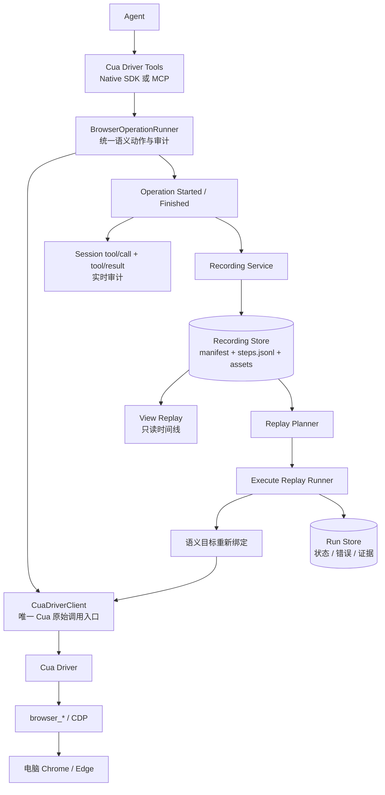

# Cua Driver 浏览器 Record / Replay：V1 方案与里程碑

> 日期：2026-10-30  
> 目标：**不使用 `dsh_browser`，由 Agent 通过 Cua Driver 操作电脑浏览器，并逐步获得 Record、查看回放和真实执行回放能力。**

## 1. 路线与范围

### 核心决策

1. 浏览器执行只走 **Cua Driver**，不调用 `dsh_browser_*`、`ElectronBrowserProvider` 或其 history/replay。
2. V1 以 Cua Driver 能稳定绑定的 **本机 Chrome/Edge（Chromium）** 为基线，优先使用 `browser_* + CDP` 语义路径。
3. 只记录 **Agent 主动发起的操作**，不捕获人的鼠标键盘，不设计人工接管。
4. Record 与 Replay 分阶段交付：先操作，后录制；先回看，后执行。
5. DSH Session 的 `tool/call + tool/result` 用于实时审计；独立 Recording Store 用于可导出、可重放的 Recording，二者通过 `callId/recordingId/stepId` 关联。
6. Cua 自带 Recording 可作为截图/AX/视频证据，但不直接作为权威可执行脚本；权威脚本使用 DSH 的 Semantic Step。
7. Replay 遇到 CAPTCHA、权限不足、目标失效或断言失败时自动停止并报告，不请求人工接管。

### V1 支持

- Cua Driver 会话、浏览器窗口和 Tab 绑定。
- 浏览器观察、导航、点击、输入、滚动、等待和截图。
- Agent 操作自动录制、脱敏、持久化和时间线回看。
- 基于新鲜浏览器状态重新引用的 Execute Replay。
- 失败即停、取消、Run 证据和导出。

### V1 暂不支持

- 任意桌面应用和跨应用工作流。
- 人的操作录制、视频优先的像素回放。
- 多标签复杂拓扑、跨域 iframe 全场景、复杂 Canvas 和文件上传。
- 无限制自动重试、CAPTCHA 绕过和失败后人工继续。
- 右侧栏 webview 作为必交付载体；它另行经过 M0 绑定验证后再排期。

## 2. 技术架构



### 模块边界

| 模块 | 责任 |
| --- | --- |
| `BrowserOperationRunner` | 所有 Driver 共用的语义动作管线，统一生成 started/finished 审计事件 |
| `CuaDriverClient` | 包装 `listToolsJson/callTool` 或 MCP call，统一超时、取消和版本探测 |
| `CuaSessionRegistry` | DSH Session ↔ Cua session ↔ app/window/target/tab 映射与释放 |
| `BrowserActions` | 浏览器语义动作和结构化错误，不向 Agent 暴露内部 target 生命周期 |
| `RecordingService` | start/stop/status、步骤归一化、去重、脱敏、崩溃恢复 |
| `RecordingStore` | Recording 持久化、导出、资源限额；不使用 SQLite |
| `ActivityProjection` | 工具事件到实时时间线的投影 |
| `ReplayPlanner` | Schema/能力/Secret/支持范围检查，生成执行计划 |
| `ReplayRunner` | Run 状态机、目标重绑、等待、断言、失败即停和取消 |
| `EvidenceStore` | 截图、Cua Recording、错误和 Run 报告 |

`BrowserOperationRunner` 是语义动作与审计入口，V1 的 Cua 原始调用统一经过 `CuaDriverClient`，避免绕过记录、取消和权限逻辑。不要同时挂载两个拥有同一桌面浏览器的 Cua Provider。

## 3. M0 必须先验证的版本与绑定

DSH 当前实验性 Native Provider 锁定 `@trycua/cua-driver` 0.28.0，上游最新文档能力不能直接视为该版本全部具备。

M0 通过 `listToolsJson()` 和真实调用确认：

- `list_apps/list_windows/get_window_state`。
- `start_session/end_session`。
- `get_browser_state` 和所需 `browser_*` 动作。
- `run_steps` 的 role/name、`wait_for/expect`。
- `start_recording/stop_recording/replay_trajectory` 是否存在及其格式。
- Native 与 MCP 的工具目录是否一致。

浏览器绑定验收：

1. 启动或连接一个专用 Chrome/Edge 窗口。
2. 取得精确窗口、CDP target 和活动 Tab。
3. 完成打开本地页面 → 语义快照 → 输入 → 点击 → 等待 → 截图。
4. 页面导航和新建 Tab 后能重新绑定。
5. 两个 DSH Session 不会选中同一目标，或被显式互斥。

若 0.28.0 缺少必需能力，优先升级并锁定一个经过验证的 Cua Driver 版本，或在 MCP 模式使用同等版本；不以坐标操作静默代替 Browser CDP。

Native 适合快速验证；正式运行需评估原生同进程崩溃风险。MCP/独立进程具有更好的故障隔离，但需要安装、权限和生命周期管理。

## 4. Record 设计

### 4.1 记录来源

只记录 Agent 经 `BrowserOperationRunner` 发起、并由 `CuaDriverClient` 实际执行的动作：

- `operation-started`：callId、工具名、参数、DSH/Cua Session、目标引用、开始时间。
- `operation-finished`：状态、结果摘要、错误、耗时和证据引用。

观察类调用可以折叠，写类/导航类动作完整保留。无需 Human Capture，也无需页面注入。

### 4.2 存储根与目录约定

所有运行数据写入**当前工作区**：

```text
<workspaceRoot>/.dsh/record-and-replay/
```

不写入插件安装目录，也不默认写全局 `$DSH_HOME`。该目录包含页面 URL、输入摘要、截图等敏感数据，必须被 Git 忽略。建议目录权限 `0700`、文件权限 `0600`。

ID 由 Store 生成，禁止直接把用户输入拼成路径：

- Recording：`rec_20261030T035001Z_a1b2c3`。
- Run：`run_20261030T041500Z_d4e5f6`。
- ID 仅允许固定正则中的字母、数字和下划线；解析后必须确认 real path 仍位于存储根内。

### 4.3 完整文件位置结构

```text
.dsh/record-and-replay/
  .gitignore                         # 忽略本目录全部运行数据
  recordings/
    rec_20261030T035001Z_a1b2c3/
      manifest.json                  # Recording 元数据与生命周期
      steps.jsonl                    # 只追加的 Agent 操作事件
      recording.lock                 # 仅活跃录制存在；协作锁，非安全边界
      assets/
        cua/                         # 可选：Cua 原生 Recording 原始证据
          turn-00001/
            action.json
            before_state.json
            after_state.json
            before.png
            after.png
            evidence.json
          recording.mp4              # 可选，默认不生成
        screenshots/                 # DSH 额外保存的少量截图
          step-000008.png
      runs/
        run_20261030T041500Z_d4e5f6/
          run.json                   # 一次 Execute Run 的元数据与终态
          steps.jsonl                # 本次 Run 的步骤事件，不改原 Recording
          run.lock                   # 仅活跃 Run 存在
          evidence/
            step-000003/
              before.png
              after.png
              state.json
              error.json
  exports/
    rec_20261030T035001Z_a1b2c3.dshreplay
  tmp/
    rec_....tmp/                     # 创建/修复/导出的临时目录
    run_....tmp/
```

`.gitignore` 只作用于本功能目录，建议内容：

```gitignore
*
!.gitignore
```

V1 不建立第二份权威 `index.json`，Recording 列表扫描各 `manifest.json`；未来如需缓存索引，必须能从这些文件完整重建。

### 4.4 各文件职责

`manifest.json` 示例：

```json
{
  "schemaVersion": 1,
  "recordingId": "rec_20261030T035001Z_a1b2c3",
  "title": "Agent 浏览器表单任务",
  "status": "recording",
  "ownerSessionId": "session-...",
  "driver": { "name": "cua-driver", "version": "0.28.0", "transport": "native" },
  "browser": { "app": "Chrome", "startUrl": "https://example.test/form" },
  "createdAt": "2026-10-30T03:50:01.000Z",
  "updatedAt": "2026-10-30T03:50:01.000Z",
  "lastSeq": 0,
  "stepCount": 0,
  "assetRoot": "assets"
}
```

状态只允许 `recording/completed/failed/interrupted`。`lastSeq/stepCount` 是加速读取的摘要，加载时与 JSONL 对账；冲突以事件流为准并修复 manifest。

`steps.jsonl` 同时保留开始和结束事件，使 Host 崩溃后能区分“未开始”和“已开始但未完成”：

```jsonl
{"type":"step.started","schemaVersion":1,"stepId":"step_000001","seq":1,"callId":"call_a","tool":"browser_navigate","action":"navigate","args":{"url":"https://example.test"},"startedAt":1793334601000}
{"type":"step.finished","schemaVersion":1,"stepId":"step_000001","callId":"call_a","status":"success","finishedAt":1793334601950,"durationMs":950,"resultSummary":{"url":"https://example.test/form"}}
{"type":"step.started","schemaVersion":1,"stepId":"step_000002","seq":2,"callId":"call_b","tool":"browser_click","action":"click","target":{"url":"https://example.test/form","semantic":{"role":"button","name":"提交"}},"startedAt":1793334602100}
{"type":"step.finished","schemaVersion":1,"stepId":"step_000002","callId":"call_b","status":"success","finishedAt":1793334602195,"durationMs":95,"evidence":["assets/screenshots/step-000002.png"]}
```

读取投影将 started/finished 按 `stepId + callId` 配对。恢复时，没有 finished 的已持久化 started 标为 `interrupted`，不伪造成功结果。

`run.json` 保存 `runId/recordingId/recordingHash`、驱动版本、状态 `preparing/running/completed/failed/cancelled`、当前 step、起止时间和终态错误。每次执行都有新目录；View Replay 不创建 Run。

`assets/cua/` 是可选原始证据，`assets/screenshots/` 只保存 DSH 额外生成的图片。JSON 中一律使用 Recording 内的相对 POSIX 路径，不写本机绝对路径。

### 4.5 写入、锁与崩溃恢复

1. 创建 Recording 时先写 `tmp/rec_....tmp/`，初始化完成后原子 rename 到 `recordings/<recordingId>/`。
2. `manifest.json/run.json` 在同目录写临时文件，flush 后原子 rename；不直接覆盖写半个 JSON。
3. `steps.jsonl` 只追加完整的一行 JSON；Agent 操作频率低，finished 事件落盘后再向 UI 报告“已持久化”。
4. 活跃 Recording/Run 各只有一个 writer。lock 保存 `ownerSessionId/pid/startedAt/heartbeatAt`；它是协作锁，进程消失且心跳过期后由 Store 回收。
5. 重启时读取到最后一条完整 JSONL；不完整尾部必须报告。修复前先备份原文件，再截断坏尾，不静默丢数据。
6. `tmp/` 只清理已超过恢复窗口且不属于活跃进程的临时目录；不自动删除 Recording/Run。
7. 导出只包含 manifest、steps 和选择的 assets；排除 lock/tmp。Run 默认不包含，用户选择时才附加。

建议初始限额均可配置：每 Recording 10,000 步、assets 500 MiB、最多保留 50 个 Run；视频默认关闭。超过限额时停止新增资产或录制并给出明确错误，不能静默截断步骤。

### 4.6 引用与脱敏规则

- `target_id/tab_id/browser ref/element_token/pid/window_id` 都视为短期运行时引用。
- Recording 必须保存可重新定位的语义信息：app、URL、role/name/text 等。
- 从最新快照建立 `ref → semantic locator` 映射；无法恢复语义的信息标记 `replayUnsupported`，不假装可以稳定重放。
- Cookie、Authorization、密码和令牌不落盘；输入值默认脱敏或保存 `secretRef`。
- 截图和视频可选，不作为执行回放的必要条件。
- manifest 原子更新，steps.jsonl 只追加，崩溃后恢复到最后一条完整记录。

## 5. Replay 分三层交付

### R0：View Replay，只读回看

- 按 seq 展示动作、目标、耗时、结果和错误。
- 查看已有截图/证据。
- 展开详情不访问浏览器，不调用 Cua 动作。

### R1：Trajectory Replay，兼容性快捷路径

如果当前 Cua 版本提供 `replay_trajectory`，可用于验证“原始工具调用顺序重放”。它只作为实验能力：

- 依赖旧引用和页面状态，脆弱性明确标注。
- 不作为 V1 稳定回放的唯一实现。
- 不承诺跨浏览器窗口或跨 Session 可重放。

### R2：Semantic Execute Replay，V1 正式目标

1. 加载 Recording，生成 Plan，列出不支持步骤和所需权限。
2. 创建新的 Run 和 Cua Session，重新绑定浏览器与 Tab。
3. 每步读取新鲜 Browser/Window State。
4. 根据 URL + role/name/text 等语义信息生成新 ref/token。
5. 通过 `BrowserOperationRunner` 和 `CuaDriverClient` 执行，标记 `origin=replay`，不写回原 Recording。
6. 使用 URL、元素状态或 `expect` 验证结果，不按原录制耗时机械等待。
7. 失败、取消或 CAPTCHA 即停止，保存当前步骤和证据。
8. 输出独立 Run 报告；重试创建新 Run，不改写历史。

Run 状态保持简单：

```text
preparing → running → completed
                    → failed
                    → cancelled
```

V1 不做暂停、单步、人工接管和自动修复。

## 6. 里程碑节点

| 里程碑 | 主要交付 | 工期 | 验收门槛 |
| --- | --- | ---: | --- |
| **M0：Cua 可行性 Spike** | 版本锁定、Native/MCP 选择、Chrome/Edge 精确绑定、最小动作链 | 2～3 人日 | 不用 `dsh_browser` 完成导航/输入/点击/等待/截图；确认 Record/Replay 工具目录 |
| **M1：Browser Driver 可用** | `CuaDriverClient`、Session Registry、Browser Actions、取消/超时/结构化错误 | 3～4 人日 | Agent 可连续完成 10 步本地页面任务；导航/新 Tab 后可重绑；无跨 Session 串控 |
| **M2：Record 可用** | Operation Events、Recording Service/Store、脱敏、恢复和 Recording 清单 | 3～4 人日 | 每个 Agent 动作恰好记录一次；状态/耗时/错误完整；重启后 Recording 可读；秘密不落盘 |
| **M3：View Replay 可用** | 只读时间线、详情、证据和导出 | 2～3 人日 | 回看/翻页/导出零浏览器动作；能看到成功与失败原因 |
| **M4：Execute Replay MVP** | Planner、Semantic Runner、目标重绑、等待/断言、Run Store | 4～6 人日 | 本地 fixture 连续 20 次执行通过；目标消失或断言失败时停止并给出 stepId/证据 |
| **M5：V1 硬化发布** | 权限/并发/崩溃/取消测试、限额、版本兼容和文档 | 3～4 人日 | 权限撤销有明确错误；取消不继续发动作；损坏 Recording 可诊断；支持矩阵完整 |

**合计约 17～23 人日，按 4 个周迭代安排。** 右侧栏 webview 若在 M0 验证通过，可作为 M1 的额外载体；未通过则单独评估 CDP Target Bridge，不影响电脑 Chrome/Edge 主线。

## 7. 推荐周节奏

### 第 1 周：Agent 真正能操作浏览器

完成 M0，进入并完成 M1。周末演示：Agent 使用 Cua Driver 在本机 Chrome/Edge 完成一个完整表单任务，没有 `dsh_browser` 调用。

### 第 2 周：知道 Agent 做了什么

完成 M2 和 M3。周末演示：同一任务自动形成 Recording，刷新后仍能查看每个步骤、结果、错误和截图。

### 第 3 周：能够真实重跑

完成 M4。周末演示：从 Recording 创建新 Run，在新绑定的浏览器目标中完成语义回放；制造一次元素缺失，确认失败即停和证据完整。

### 第 4 周：达到 V1 可试用

完成 M5，冻结 Schema 和驱动版本，完成发布文档与回归。

## 8. PR 拆分

1. **PR1：Cua Client + Capability Probe + Session Registry**。
2. **PR2：Browser Actions + 本机 Chrome/Edge E2E**。
3. **PR3：Recording Schema + Store + Agent Operation Recording**。
4. **PR4：只读 View Replay + Export**。
5. **PR5：Semantic Execute Runner + Run Evidence**。
6. **PR6：并发、权限、恢复和发布硬化**。

不要把“浏览器绑定、录制、执行回放和 UI”塞进首个 PR。

## 9. 核心测试与发布门槛

### 单元测试

- 能力目录解析与不支持能力错误。
- Operation started/finished 关联、并发和去重。
- 短期 ref 到语义 Locator 的映射。
- Recording 状态、脱敏、JSONL 截断恢复和原子写。
- Replay Plan、目标重绑、失败即停、取消和 Run 状态。

### 真实浏览器 E2E

- 本地 fixture：导航、动态表单、异步元素、截图、导航后 target 更新。
- 浏览器关闭、CDP 断开、权限撤销和 Cua Driver 重启。
- 两个 DSH Session 的绑定隔离与同目标互斥。
- 取消后读取新状态，不假设已投递输入被回滚。
- View/Export 全过程零 Cua 写动作。

V1 发布门槛：确定性 fixture **20/20**；任何失败均有 `recordingId/runId/stepId`、错误码和证据；任何 Replay 都不修改原 Recording。

## 10. V1 完成定义

V1 完成不代表能操作所有桌面软件，而是同时满足：

1. Agent 不使用 `dsh_browser`，能通过 Cua Driver 稳定操作本机 Chrome/Edge。
2. Agent 的浏览器动作能自动形成可恢复、可脱敏、可导出的 Recording。
3. 用户能无副作用回看 Agent 的操作过程。
4. 系统能对支持的 Recording 创建真实 Execute Run，并在失败时安全停止、给出证据。
